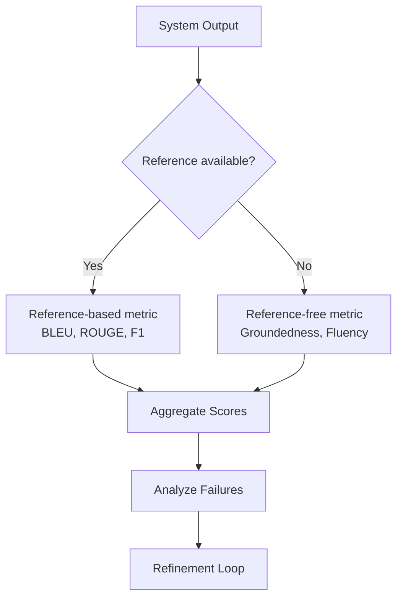

# 01.2.4 Evaluation-Refining-The-System

  <table>
    <tr>
      <td align="center"></td>
      <td align="center"></td>
      <td align="center"></td>
      <td align="center"></td>
    </tr>
  </table>

## 01.2.4.1 Metrics

### <td align="center"> Introduction

**Metrics** are the objective measurement layer of the NLP/NLU/NLG pipeline. After language has been processed, understood, and generated, metrics answer the essential question:

> **"How good is the output, and is the system getting better or worse?"**

A metric turns a quality judgment into a **number** that can be tracked, compared, and acted on. Without metrics, "the model seems better" is just an opinion; with metrics, improvement becomes measurable and repeatable.

Because each stage of the pipeline produces a different kind of output, each stage needs a different kind of metric:

| Stage | Produces | Example question a metric answers |
|-------|----------|-----------------------------------|
| **NLP** (processing) | Tokens, embeddings, retrieved items | Did we retrieve the right documents? |
| **NLU** (understanding) | Intents, entities, labels | Was the intent classified correctly? |
| **NLG** (generation) | Generated text | Is the generated answer accurate and fluent? |

---

### <td align="center"> Why use it?

- **You cannot improve what you do not measure** — metrics turn quality into a trackable signal
- **Detect regressions** — catch when a change makes the system worse before users do
- **Compare options** — choose between models, prompts, chunking strategies, or retrievers objectively
- **Set quality gates** — block deployments that fall below a threshold
- **Align with goals** — translate business goals (accuracy, trust, cost) into numbers
- **Enable the refinement loop** — metrics are the feedback that drives the next iteration (see [Feedback & RL](./1-2-4-2-Feedback_RL.md))

Without metrics, teams optimize blindly and rely on anecdotes, which leads to silent quality drift over time.

---

### <td align="center"> How it works?

#### Step-by-step Process

1. **Define the objective**
   - What does "good" mean for this task? (correct label, faithful answer, relevant retrieval)

2. **Choose the metric type**
   - **Reference-based** — compare output against a gold/expected answer
   - **Reference-free** — judge the output on its own (fluency, groundedness)
   - **Human evaluation** — people rate the output on defined criteria

3. **Build an evaluation set**
   - A curated dataset of inputs with known expected outputs (the "golden set")

4. **Compute the metric**
   - Run the system over the set and score each output

5. **Aggregate and interpret**
   - Average scores, inspect failures, segment by category

6. **Act**
   - Feed the results back into refinement (prompt changes, fine-tuning, RL)

#### Example Flow

#### Common Metrics by Task

| Task | Metric | Measures |
|------|--------|----------|
| **Classification (NLU)** | Accuracy, Precision, Recall, F1 | Correctness of predicted labels |
| **Retrieval (NLP)** | Precision@k, Recall@k, MRR, nDCG | Whether relevant items are retrieved and ranked high |
| **Generation (NLG)** | BLEU, ROUGE, METEOR | Overlap with a reference text |
| **Generation (semantic)** | BERTScore, Cosine Similarity | Meaning similarity, not just word overlap |
| **Language Modeling** | Perplexity | How well the model predicts the next token |
| **RAG / Faithfulness** | Groundedness, Faithfulness, Context Relevance | Whether the answer is supported by retrieved context |
| **Operational** | Latency, Cost per query, Throughput | Production efficiency |

---

### <td align="center"> Components

**1. Evaluation Dataset (Golden Set)**
A curated set of inputs paired with expected outputs:
- Representative of real usage
- Covers edge cases and hard examples
- Versioned so results stay comparable over time

**2. Reference-based Metrics**
Compare output to a known-correct answer:
- **Classification:** Accuracy, Precision, Recall, F1
- **Overlap:** BLEU (precision-oriented), ROUGE (recall-oriented), METEOR
- **Retrieval:** Precision@k, Recall@k, MRR, nDCG

**3. Reference-free / Model-based Metrics**
Judge output quality without a gold answer:
- **Embedding-based:** BERTScore, cosine similarity
- **LLM-as-a-judge:** a strong model scores correctness, relevance, or tone
- **Groundedness / Faithfulness:** does the answer stay within the provided context?

**4. Human Evaluation**
The gold standard for subjective quality:
- Rating scales (1–5), pairwise preference, A/B tests
- Criteria: correctness, helpfulness, coherence, safety

**5. Operational Metrics**
Beyond quality — the cost of serving it:
- Latency (p50/p95), cost per query, token usage, error rate

---

### <td align="center"> Use Cases

- **Model/Prompt selection** — pick the best option with objective scores instead of intuition
- **Regression testing** — run metrics in CI to block quality drops before release
- **RAG evaluation** — measure retrieval relevance and answer groundedness separately
- **Chatbot quality tracking** — monitor intent accuracy and response quality over time
- **Summarization quality** — score ROUGE/BERTScore against reference summaries
- **Benchmarking** — compare systems on standard datasets
- **Production monitoring** — track latency, cost, and quality live in deployment

---

###  Limitations

- **Overlap metrics (BLEU/ROUGE) ignore meaning** — a correct paraphrase can score low
- **A good score is not a correct answer** — metrics measure proxies, not ground truth
- **Golden sets go stale** — they must be maintained as the domain evolves
- **Reference-free metrics can be gamed** — fluent text may still be wrong
- **LLM-as-a-judge has its own biases** — position bias, verbosity bias, self-preference
- **Human evaluation is slow and expensive** — hard to scale, and raters disagree
- **Single numbers hide failure modes** — always inspect per-segment and worst-case results

> A metric is a compass, not the destination. Combine automatic metrics with human review, and always read the failures behind the number.
