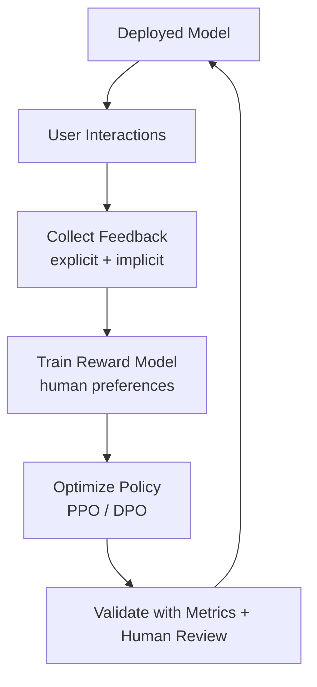

# 01.2.4 Evaluation-Refining-The-System

<div align="center">
  <table>
    <tr>
      <td align="center"></td>
      <td align="center"></td>
      <td align="center"></td>
      <td align="center"></td>
    </tr>
  </table>
</div>

## 01.2.4.2 Feedback & Reinforcement Learning

### <td align="center"> Introduction

If [Metrics](./1-2-4-1-Metrics.md) tell you **how good** the system is, **Feedback & Reinforcement Learning** is how you **make it better**. This is the stage that closes the loop: it takes signals about the system's behavior and uses them to refine the model over time.

> **"How do we turn feedback about the output into an improvement in the next version?"**

Feedback can be **explicit** (a thumbs-up, a star rating, a correction) or **implicit** (the user retried, rephrased, or abandoned the task). Reinforcement Learning (RL) is the technique that converts that feedback into a **reward signal** and optimizes the model to produce outputs people prefer — the core idea behind **RLHF** (Reinforcement Learning from Human Feedback).

```
Generate output -> Collect feedback -> Turn feedback into reward -> Optimize model -> Repeat
```

This is what makes a system a **learning system** rather than a static one.

---

### <td align="center"> Why use it?

- **Continuous improvement** — the system gets better from real usage, not just initial training
- **Align with human preference** — optimize for what people actually find helpful, safe, and correct
- **Capture what metrics miss** — tone, helpfulness, and nuance are hard to score but easy to feel
- **Reduce harmful or low-quality outputs** — reward good behavior, penalize bad behavior
- **Build a data flywheel** — every interaction becomes training signal for the next iteration
- **Adapt to drift** — keep up as users, language, and the domain change

Without a feedback loop, a system is frozen at launch quality and slowly becomes outdated.

---

### <td align="center"> How it works?

#### Step-by-step Process

1. **Collect feedback**
   - Explicit: ratings, corrections, preference between two answers
   - Implicit: retries, abandonment, dwell time, acceptance

2. **Turn feedback into a reward signal**
   - Train a **reward model** that predicts how much humans would prefer a given output
   - Or use direct preference pairs (chosen vs. rejected)

3. **Optimize the policy (the model)**
   - Use an RL algorithm to adjust the model so it produces higher-reward outputs

4. **Validate**
   - Re-run [Metrics](./1-2-4-1-Metrics.md) and human review to confirm it actually improved

5. **Deploy and monitor**
   - Ship the refined model and keep collecting feedback — the loop continues

#### The RLHF Loop



#### Approaches

| Approach | How it refines the model | Notes |
|----------|--------------------------|-------|
| **Supervised Fine-Tuning (SFT)** | Train on corrected / ideal examples | Usually the first step before RL |
| **RLHF (PPO)** | Reward model + Proximal Policy Optimization | The classic alignment method |
| **DPO (Direct Preference Optimization)** | Optimizes directly on preference pairs | Simpler, no separate reward model |
| **RLAIF** | AI feedback replaces some human labels | Scales feedback collection |
| **Bandit / online learning** | Updates from live reward signals | For ranking and recommendation |

---

### <td align="center"> Components

**1. Feedback Sources**
Where the learning signal comes from:
- **Explicit:** thumbs up/down, 1–5 ratings, written corrections, A/B preference
- **Implicit:** retries, rephrasing, abandonment, click/acceptance, time-on-task

**2. Reward Model**
A model trained to score outputs by predicted human preference:
- Learns from pairs of (preferred, rejected) responses
- Acts as a stand-in for a human rater during optimization

**3. Optimization Algorithm**
The method that updates the model toward higher reward:
- **PPO** (Proximal Policy Optimization) — stable RL fine-tuning
- **DPO** — trains directly on preferences without a reward model
- Constrained so the model does not drift too far from its base behavior

**4. Human-in-the-Loop**
People who provide and curate feedback:
- Labelers who rank outputs
- Domain experts who correct errors
- Guidelines that keep judgments consistent

**5. Data Flywheel**
The infrastructure that captures, stores, and recycles feedback:
- Logs interactions and outcomes
- Builds preference datasets
- Feeds the next training cycle

---

### <td align="center"> Use Cases

- **Chatbot / assistant alignment** — tune responses to be more helpful, safe, and on-tone
- **Ranking & recommendation** — learn from clicks and acceptance to reorder results
- **Content moderation** — reduce harmful or policy-violating outputs via penalties
- **Code assistants** — learn from accepted vs. rejected suggestions
- **Search relevance** — refine retrieval ordering from implicit engagement
- **Customer support** — improve answers using resolution and satisfaction signals
- **Personalization** — adapt tone and content to user preferences over time

---

###  Limitations

- **Reward hacking** — the model may exploit the reward model instead of truly improving
- **Feedback bias** — vocal or specific user groups can skew the signal
- **Noisy implicit signals** — a retry can mean many different things
- **Expensive human labeling** — high-quality preference data is costly and slow
- **Training instability** — RL fine-tuning (e.g., PPO) is sensitive and hard to tune
- **Over-optimization** — pushing too hard can reduce diversity or cause bland, evasive answers
- **Feedback latency** — it takes volume and time before signals are reliable enough to train on

> Treat the reward signal as an approximation of human intent, not the truth itself — and always validate improvements with independent [Metrics](./1-2-4-1-Metrics.md) and human review.
