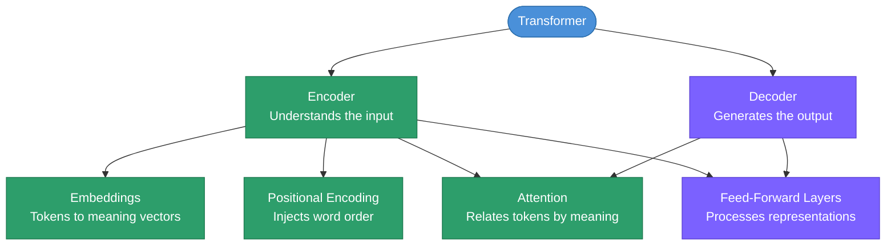
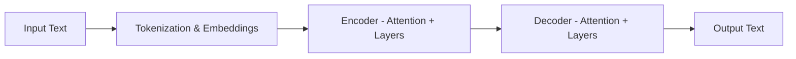

# 02. Transformer Architecture

<div align="center">
  <table>
    <tr>
      <td align="center"></td>
      <td align="center"></td>
      <td align="center"></td>
      <td align="center"></td>
      <td align="center"></td>
      <td align="center"></td>
    </tr>
  </table>
</div>

##  Overview

The **Transformer** is the architecture that powers virtually every modern Large Language Model. Introduced in 2017 in the paper *"Attention Is All You Need"*, it replaced the slow, word-by-word processing of earlier models with a design that reads an entire sequence **at once** and learns how every token relates to every other token through a mechanism called **attention**.

> **"How does a model turn one sequence into another — and understand meaning without reading word by word?"**

This section breaks the Transformer into its two halves — the **Encoder** (which understands the input) and the **Decoder** (which generates the output) — and shows how attention, embeddings, and stacked layers work together.

| Aspect | Older Sequential Models (RNN / LSTM) | Transformer |
|--------|--------------------------------------|-------------|
| Processing | Word by word, left to right | Whole sequence in parallel |
| Long-range dependencies | Weak (vanishing gradients) | Strong (self-attention) |
| Parallelization | Difficult | Native |
| Context handling | Limited / local | Global across the sequence |
| Scalability | Limited | Scales to billions of parameters |

---

### <td align="center"> Introduction

Transformers were originally created to solve **sequence-to-sequence** problems — turning one sequence of information into another, such as translating a sentence from one language to another. Because they *transform* an input into an output, they are called "Transformers".

Instead of reading text step by step like a human, a Transformer looks at the whole sentence and focuses on the **relationships** between words. It learns which words are important to each other and which provide context, using the idea of **attention** — learning where to "pay attention" when understanding or generating text.

> **Key mindset:** A word is not a fixed dictionary entry. A Transformer turns each token into a **context-aware meaning vector** that reflects how the word is being used in the sentence.

---

### <td align="center"> Why use it?

Transformers became the foundation of modern AI because they:

- **Scale efficiently** with large datasets and model sizes
- **Process tokens in parallel** (unlike RNNs that go one word at a time)
- **Capture long-range dependencies** using self-attention
- **Generalize across modalities** (text, images, audio)
- **Provide a unified architecture** for NLP, vision, and multimodal tasks

> These properties are exactly why Transformers became the basis for **foundation models** like BERT, GPT, and the LLMs explored in the next section.

---

### <td align="center"> Components

A Transformer is built from a small set of repeating building blocks. Understanding each one makes the full architecture easy to follow.



| Component | Role |
|-----------|------|
| **Encoder** | Reads the input and turns it into context-aware representations |
| **Decoder** | Uses those representations to generate the output, one token at a time |
| **Embeddings** | Convert tokens into numerical meaning vectors |
| **Positional Encoding** | Adds information about the order of words |
| **Attention** | Learns how strongly each token relates to the others |
| **Feed-Forward Layers** | Process and refine the representations in each layer |

> In the original Transformer, the Encoder and Decoder are each a stack of **6 identical layers**; the output of one layer feeds the next. Modern models use more or fewer layers depending on the task.

---

### <td align="center"> How it works?

At a high level, data flows from input text to output text through the Encoder and Decoder:



Internally, the process follows these steps:

1. The input text is broken into smaller pieces called **tokens**.
2. Tokens are converted into **embeddings** and combined with **positional information**.
3. **Attention** analyzes the relationships between all tokens.
4. The results pass through **feed-forward processing layers**.
5. **Multiple stacked layers** refine the understanding step by step.
6. The **Decoder** generates the output autoregressively — one token at a time — until it produces an end-of-sequence token.

> **Plain-language analogy:** think of a human translator — reading words (embeddings), understanding meaning and context (Encoder + attention), then speaking the translation (Decoder).

---

### <td align="center"> Use Cases

| Domain | Application |
|--------|-------------|
| **Machine Translation** | Translating text between languages (the original use case) |
| **Text Summarization** | Condensing long documents into short summaries |
| **Question Answering** | Answering questions from a passage or knowledge base |
| **Conversational AI** | Chatbots and virtual assistants |
| **Code Generation** | Writing and completing source code |
| **Speech Recognition** | Converting audio into text |
| **Vision** | Image captioning and Vision Transformers (ViT) |

---

###  Limitations

| Limitation | Description |
|------------|-------------|
| **Quadratic attention cost** | Self-attention scales with the square of sequence length, making very long inputs expensive |
| **Context window limits** | The model can only attend to a fixed maximum number of tokens at once |
| **High compute & data needs** | Training requires large datasets and significant GPU/TPU resources |
| **Lack of inherent order** | Word order must be added explicitly via positional encoding |
| **Interpretability** | Internal attention patterns are hard to fully explain |
| **Data bias** | Patterns learned from training data can reproduce its biases |

---

###  Real-Life Transformer Models

| Model | Year | Focus |
|-------|------|-------|
| **BERT** (Google) | 2018 | Bidirectional understanding; question answering, search |
| **GPT** (OpenAI) | 2018+ | Autoregressive text generation |
| **LaMDA** (Google) | 2021 | Conversational / dialogue applications |

---

##  Transformer Architecture Structure

```
02-Transformer-Architecture/
├── 02-1-What-is-a-Transformer.md     # Overview, history, encoder-decoder big picture
├── 02-2-The-Encoder-Workflow.md      # How the encoder builds context-aware representations
└── 02-3-The-Decoder-Workfkow.md      # How the decoder generates output autoregressively
```

---

###  References

- [DataCamp — How Transformers Work](https://www.datacamp.com/tutorial/how-transformers-work)
- [Building a Transformer with PyTorch](https://www.datacamp.com/tutorial/building-a-transformer-with-py-torch)
- [Build a Transformer from Scratch (notebook)](https://github.com/gil-son/language-ai-engineering-lab/tree/main/notebooks/02-Transformers)
