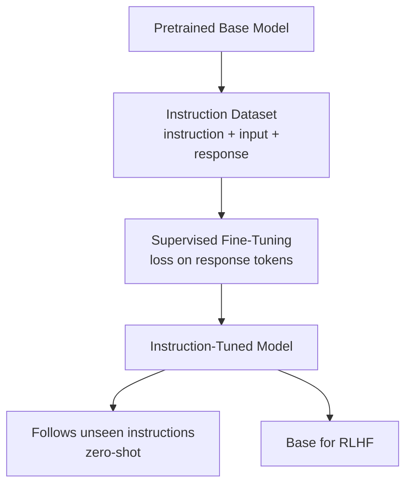

# 03. Fundamentals

<div align="center">
  <table>
    <tr>
      <td align="center"></td>
      <td align="center"></td>
    </tr>
  </table>
</div>
<br/>

---

<div align="center">
  <table>
    <tr>
      <td align="center"></td>
      <td align="center"></td>
      <td align="center"></td>
      <td align="center"></td>
      <td align="center"></td>
      <td align="center"></td>
      <td align="center"></td>
    </tr>
  </table>
</div>
<br/>

## 03.7. Instruction Tuning

### <td align="center"> Introduction

---

A **pretrained base model** is excellent at predicting the next token, but it does not naturally **follow instructions**. Ask a raw base model "Summarize this text" and it may continue the text, rephrase the question, or drift — because it was trained to continue text, not to obey commands.

**Instruction Tuning** fixes this. It is a specialized form of **supervised fine-tuning (SFT)** in which the model is trained on many examples of **(instruction, response)** pairs across a wide variety of tasks. This teaches the model a general skill: *read an instruction and produce the response the user intended*.

It sits between pretraining and alignment in the training lifecycle:

```
Pretraining  ->  Fine-tuning / Instruction Tuning  ->  RLHF
(predict text)   (follow instructions)                (match human preference)
```

> **Core idea:** Pretraining teaches the model *language*. Instruction tuning teaches it to be *useful* — to turn a request into a helpful answer, even for tasks it has never seen.

---

### <td align="center"> Why use it?

- **Zero-shot generalization** — a model tuned on many tasks follows *new* instructions it was never explicitly trained on
- **Usability** — turns a raw base model into something that behaves like an assistant
- **Consistent format** — the model learns to answer directly instead of continuing the prompt
- **Bridge to chat models** — it is the step that transforms a base model into a chat/instruct model
- **Cheaper than RLHF** — pure supervised learning, no reward model or RL loop required
- **Foundation for alignment** — provides the starting point that RLHF later refines

---

### <td align="center"> Components

- **Base Model** — a pretrained LLM (e.g., LLaMA, Mistral, Falcon)
- **Instruction Dataset** — many examples, each with:
  - an **instruction** ("Translate to French")
  - an optional **input** (the text to act on)
  - the **target response** (the ideal answer)
- **Task Diversity** — the dataset spans many task types (summarize, classify, extract, reason, code) so the model generalizes
- **Prompt Template** — a consistent structure that wraps instruction + input + response
- **Training Objective** — standard next-token (causal LM) loss, usually computed only on the response tokens
- **Evaluation Set** — held-out, unseen instructions to measure generalization

#### Well-known instruction datasets

| Dataset | Notes |
|---------|-------|
| **FLAN** | Large collection of academic NLP tasks reformatted as instructions |
| **Super-NaturalInstructions** | 1,600+ diverse tasks with instructions |
| **Alpaca** | Instructions generated via Self-Instruct from a stronger model |
| **Dolly** | Human-written instruction/response pairs |
| **OpenAssistant (OASST)** | Crowd-sourced assistant-style conversations |

---

### <td align="center"> How it works?

#### Step-by-step Process

1. **Start from a pretrained base model.**
2. **Collect or build an instruction dataset** covering many task types.
3. **Format** each example with a consistent prompt template (instruction + optional input + response).
4. **Fine-tune** with next-token loss, typically masking the loss so it is computed only on the response.
5. **Evaluate** on held-out instructions to measure zero-shot generalization.
6. **Ship** the instruction-tuned model (often as the base for later RLHF).

#### Simple Diagram



#### Example formatted sample

```
### Instruction:
Summarize the following paragraph in one sentence.

### Input:
Transformers process all tokens in parallel using self-attention...

### Response:
Transformers use self-attention to process tokens in parallel and capture context.
```

---

### <td align="center"> Use Cases

- **Building assistant / chat models** from a raw base model
- **Task generalization** — one model handling summarization, extraction, Q&A, and more
- **Domain instruction following** — tuning on domain-specific instructions (legal, medical, support)
- **Smaller specialized models** — a compact base tuned to follow a narrow set of instructions well
- **Bootstrapping** — producing the SFT model that RLHF (03.8) then aligns

---

###  Limitations

- **Quality depends on data** — narrow or low-quality instructions limit generalization
- **Surface imitation** — the model may learn the *style* of good answers without deeper correctness
- **No preference optimization** — it does not learn which of two good answers humans prefer (that is RLHF)
- **Format overfitting** — tuning on one template can hurt performance on others
- **Hallucinations persist** — instruction tuning improves *following*, not *factuality*
- **Catastrophic forgetting** — aggressive tuning can erode general pretrained abilities

---

###  References

- [Finetuned Language Models Are Zero-Shot Learners (FLAN)](https://arxiv.org/abs/2109.01652)
- [Self-Instruct: Aligning LMs with Self-Generated Instructions](https://arxiv.org/abs/2212.10560)
- [Super-NaturalInstructions](https://arxiv.org/abs/2204.07705)
- Next: **[03.8. RLHF](./03-8-RLHF.md)** — aligning the instruction-tuned model with human preferences
