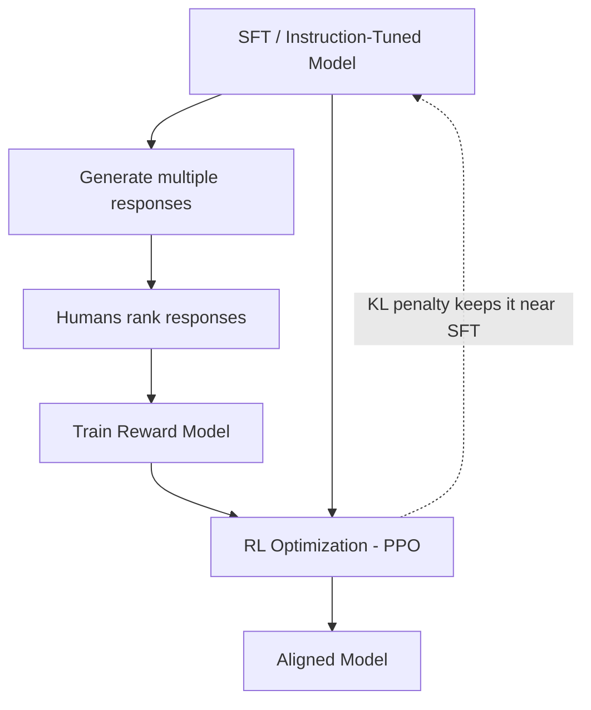

# 03. Fundamentals

<div align="center">
  <table>
    <tr>
      <td align="center"></td>
      <td align="center"></td>
    </tr>
  </table>
</div>
<br/>

---

<div align="center">
  <table>
    <tr>
      <td align="center"></td>
      <td align="center"></td>
      <td align="center"></td>
      <td align="center"></td>
      <td align="center"></td>
      <td align="center"></td>
      <td align="center"></td>
    </tr>
  </table>
</div>
<br/>

## 03.8. RLHF (Reinforcement Learning from Human Feedback)

### <td align="center"> Introduction

---

Instruction tuning (03.7) teaches a model to **follow instructions**, but it cannot easily teach *which* of several valid answers people actually **prefer** — the one that is more helpful, more honest, safer, or better-toned. These qualities are hard to capture with a fixed target label.

**RLHF — Reinforcement Learning from Human Feedback** — solves this by learning directly from **human preferences**. Humans compare model outputs and say which is better; those comparisons train a **reward model**; and the LLM is then optimized to produce outputs the reward model scores highly.

RLHF is the final alignment stage of the classic training lifecycle and the technique behind assistants like **ChatGPT** and **Claude**:

```
Pretraining  ->  Instruction Tuning (SFT)  ->  RLHF
(predict text)   (follow instructions)         (match human preference)
```

> **Core idea:** Instead of telling the model the *one right answer*, RLHF shows it *which answers humans prefer* and optimizes the model toward them.

This section is the model-training view of the same idea introduced, at the pipeline level, in **[01.2.4.2 Feedback & RL](https://github.com/gil-son/language-ai-engineering-lab/tree/main/01-Human-Language-and-NLP/01-2-NLP-NLU-NLG-Pipeline/01-2-4-Evaluation-Refining-the-System)**.

---

### <td align="center"> Why use it?

- **Alignment** — makes outputs more helpful, honest, and harmless
- **Captures what labels can't** — tone, nuance, and preference that are easy to feel but hard to annotate
- **Reduces harmful outputs** — penalizes unsafe or low-quality responses
- **Improves usability** — the jump in quality that turned instruction models into popular assistants
- **Optimizes a soft goal** — "be the kind of answer people prefer" rather than a single fixed target

---

### <td align="center"> Components

- **SFT Model** — the instruction-tuned model that RLHF starts from
- **Preference Dataset** — pairs/rankings of outputs, labeled by humans ("A is better than B")
- **Reward Model (RM)** — trained on those preferences to score any output by predicted human preference
- **Policy** — the LLM being optimized (its outputs are the "actions")
- **RL Algorithm** — typically **PPO** (Proximal Policy Optimization)
- **KL Penalty** — keeps the optimized model close to the SFT model so it does not drift or degrade
- **Human Labelers** — provide and curate the preference comparisons

---

### <td align="center"> How it works?

RLHF is classically a **three-stage** process:

1. **Supervised Fine-Tuning (SFT)**
   - Start from a base model and fine-tune on high-quality instruction/response data (this is instruction tuning, 03.7).

2. **Train the Reward Model**
   - Generate several responses to the same prompt.
   - Humans rank them from best to worst.
   - Train a reward model to predict those human preferences.

3. **Optimize with RL (PPO)**
   - The LLM generates responses; the reward model scores them.
   - PPO updates the LLM to increase expected reward.
   - A KL penalty prevents it from straying too far from the SFT model.

#### Diagram



#### Newer alternatives

| Method | Idea |
|--------|------|
| **DPO (Direct Preference Optimization)** | Optimizes directly on preference pairs — no separate reward model or RL loop |
| **RLAIF** | Uses AI-generated feedback in place of some human labels, to scale |
| **Constitutional AI** | Uses a set of written principles to guide the feedback (used by Claude) |

---

### <td align="center"> Use Cases

- **Chat assistant alignment** — the core method behind modern assistants
- **Safety tuning** — reducing harmful, biased, or policy-violating outputs
- **Tone and helpfulness** — shaping responses to be clear and user-friendly
- **Preference-based ranking** — choosing between multiple valid answers
- **Domain alignment** — tuning behavior to an organization's standards

---

###  Limitations

- **Reward hacking** — the model may exploit the reward model instead of truly improving
- **Expensive human labeling** — high-quality preference data is costly and slow
- **Training instability** — PPO is sensitive and hard to tune
- **Over-optimization ("alignment tax")** — pushing too hard can reduce capability or make answers bland/evasive
- **Bias in feedback** — preferences reflect the labelers who provided them
- **Complexity** — a full RLHF pipeline (SFT + RM + PPO) is harder to run than plain fine-tuning

> Treat the reward model as an *approximation* of human intent, not the truth — and validate improvements with independent evaluation (03.9).

---

###  References

- [Training language models to follow instructions with human feedback (InstructGPT)](https://arxiv.org/abs/2203.02155)
- [Direct Preference Optimization (DPO)](https://arxiv.org/abs/2305.18290)
- [Constitutional AI (Anthropic)](https://arxiv.org/abs/2212.08073)
- [Hugging Face — Illustrating RLHF](https://huggingface.co/blog/rlhf)
- Next: **[03.9. LLM Evaluation](./03-9-LLM-Evaluation.md)** — measuring the aligned model
