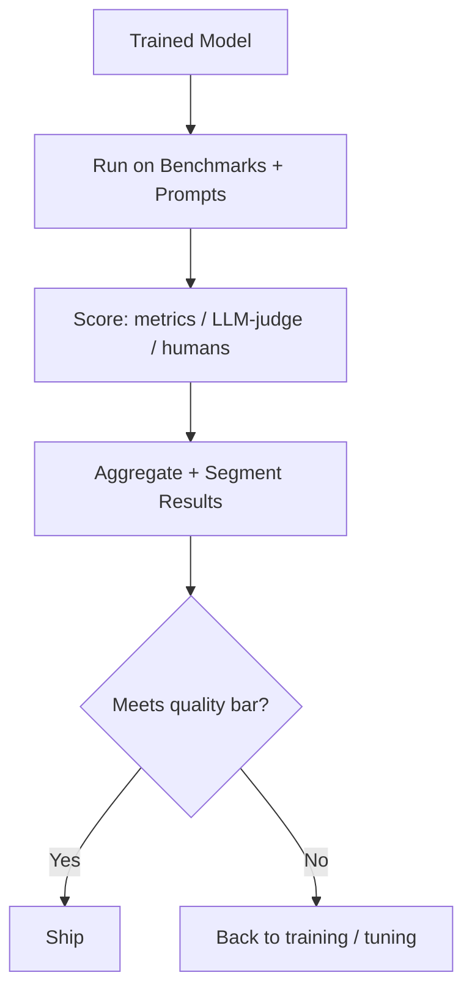

# 03. Fundamentals

  <table>
    <tr>
      <td align="center"></td>
      <td align="center"></td>
    </tr>
  </table>

 

---

  <table>
    <tr>
      <td align="center"></td>
      <td align="center"></td>
      <td align="center"></td>
      <td align="center"></td>
      <td align="center"></td>
      <td align="center"></td>
      <td align="center"></td>
    </tr>
  </table>

 

## 03.9. LLM Evaluation

### <td align="center"> Introduction

---

After pretraining, fine-tuning, instruction tuning, and RLHF, one question remains: **how good is the model, actually?** **LLM Evaluation** is the practice of measuring a model's quality objectively — so you can compare models, track improvements, and decide what is good enough to ship.

Because LLMs are general-purpose and their outputs are open-ended, evaluation uses several complementary lenses:

- **Benchmarks** — standardized tasks with known answers (knowledge, reasoning, coding)
- **Automatic metrics** — numeric scores like accuracy, perplexity, or BLEU/ROUGE
- **Model-based judging** — a strong LLM scores another model's output
- **Human evaluation** — people rate or compare outputs directly

> **Core idea:** no single number captures an LLM's quality. Good evaluation triangulates benchmarks, automatic metrics, model judges, and human review.

This page is the fundamentals-level view; the full system-level treatment lives in **[08-Evaluation-and-Benchmarks](https://github.com/gil-son/language-ai-engineering-lab/tree/main/08-Evaluation-and-Benchmarks)**.

---

### <td align="center"> Why use it?

- **Compare models** — choose between candidates objectively
- **Track progress** — measure whether each training step actually helped
- **Catch regressions** — detect when a change makes the model worse
- **Set release gates** — decide if a model meets the quality bar
- **Communicate capability** — benchmarks give a common language to describe a model
- **Expose weaknesses** — find failure modes (reasoning, safety, factuality) before users do

---

### <td align="center"> Components

**Evaluation approaches**

| Approach | How it works | Strength |
|----------|--------------|----------|
| **Benchmarks** | Run the model on standard datasets | Comparable, reproducible |
| **Automatic metrics** | Score outputs against references | Fast, cheap |
| **LLM-as-a-judge** | A strong model rates the output | Scales subjective quality |
| **Human evaluation** | People rate or compare outputs | Gold standard for quality |

**Common benchmarks**

| Benchmark | Measures |
|-----------|----------|
| **MMLU** | Broad knowledge across 57 subjects |
| **HellaSwag / ARC** | Commonsense reasoning |
| **GSM8K / MATH** | Math word problems and reasoning |
| **HumanEval / MBPP** | Code generation (pass@k) |
| **TruthfulQA** | Resistance to producing falsehoods |
| **MT-Bench / Chatbot Arena** | Open-ended, conversational quality |

**Common metrics**

| Metric | Used for |
|--------|----------|
| **Accuracy / F1** | Classification, multiple-choice benchmarks |
| **Perplexity** | Language modeling quality |
| **BLEU / ROUGE** | Overlap with reference text (translation, summary) |
| **pass@k** | Fraction of coding problems solved in k tries |
| **Groundedness / Faithfulness** | Whether answers are supported by context (RAG) |

---

### <td align="center"> How it works?

#### Step-by-step Process

1. **Define what "good" means** for the model's purpose (knowledge, reasoning, safety, helpfulness).
2. **Choose evaluations** — a mix of benchmarks, metrics, LLM-judge, and human review.
3. **Run** the model over the evaluation sets and capture outputs.
4. **Score** each output with the chosen methods.
5. **Aggregate and segment** — overall numbers plus per-category and worst-case analysis.
6. **Compare and decide** — rank against baselines and apply a release gate.

#### Diagram

---

### <td align="center"> Use Cases

- **Model selection** — pick the best base or fine-tuned model
- **Leaderboards** — compare models publicly (e.g., Chatbot Arena, Open LLM Leaderboard)
- **Regression testing** — verify a new version did not get worse
- **Safety & factuality checks** — measure harmful or false outputs
- **RAG evaluation** — measure groundedness and answer relevance
- **Capability profiling** — map strengths and weaknesses across task types

---

###  Limitations

- **Benchmark contamination** — test data may have leaked into training, inflating scores
- **Saturation** — top models cluster near the ceiling, so benchmarks stop discriminating
- **Metrics are proxies** — a high score is not proof of real-world quality
- **LLM-judge bias** — position, verbosity, and self-preference biases
- **Human eval is slow and costly**, and raters disagree
- **Narrow coverage** — benchmarks miss many real use cases and edge behaviors

---

###  References

- [Holistic Evaluation of Language Models (HELM)](https://arxiv.org/abs/2211.09110)
- [MMLU — Measuring Massive Multitask Language Understanding](https://arxiv.org/abs/2009.03300)
- [TruthfulQA](https://arxiv.org/abs/2109.07958)
- Deep dive: **[08-Evaluation-and-Benchmarks](https://github.com/gil-son/language-ai-engineering-lab/tree/main/08-Evaluation-and-Benchmarks)**
- Foundations: **[01.2.4.1 Metrics](https://github.com/gil-son/language-ai-engineering-lab/tree/main/01-Human-Language-and-NLP/01-2-NLP-NLU-NLG-Pipeline/01-2-4-Evaluation-Refining-the-System)**
