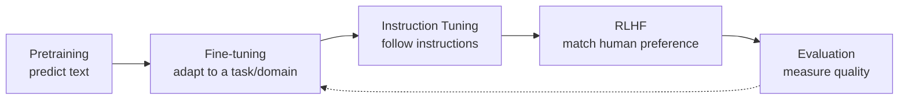

# 03. LLM Fundamentals

##  Overview

This section covers the **core concepts behind Large Language Models (LLMs)**: what they are, the terminology you need, how to set up an environment, the architectures they use, and the full **training lifecycle** that turns raw text into a helpful, aligned assistant.

> **"What is an LLM, how is it built, and how does it learn to be useful?"**

It bridges the Transformer internals from [02-Transformer-Architecture](https://github.com/gil-son/language-ai-engineering-lab/tree/main/02-Transformer-Architecture) and the applied topics that follow (prompting, context, RAG). By the end, you should understand not just *what* an LLM does, but *how* each training stage shapes its behavior.

| Aspect | Base Model (after pretraining) | Aligned Model (after the full lifecycle) |
|--------|-------------------------------|-------------------------------------------|
| Skill | Predicts the next token | Follows instructions and human preference |
| Behavior | Continues text | Answers helpfully |
| Training | Self-supervised on raw text | + Fine-tuning + Instruction tuning + RLHF |
| Usability | Low (raw) | High (assistant-like) |

---

### <td align="center"> Introduction

An LLM is a Transformer-based model trained on massive text corpora to understand and generate human language. But a raw pretrained model is not yet an assistant — it only predicts likely text. Turning it into something genuinely useful takes a **sequence of training stages**, each with a distinct purpose.

This section walks that path end to end: from the vocabulary and setup, through architecture and pretraining, to the fine-tuning and alignment stages that produce the chat models we use today.

> **Key mindset:** An LLM's behavior is the product of its *training recipe*. Understanding each stage explains why models behave — and misbehave — the way they do.

---

### <td align="center"> Why learn it?

- **Foundation** — every later topic (prompting, RAG, agents, evaluation) assumes these fundamentals
- **Reasoning about behavior** — know *why* a model hallucinates, refuses, or follows instructions
- **Better design choices** — pick models and adaptation strategies with understanding, not guesswork
- **Vocabulary** — speak the language of papers, tools, and documentation
- **Lifecycle literacy** — understand what pretraining, fine-tuning, and RLHF each contribute

---

### <td align="center"> The Training Lifecycle

The heart of this section is how an LLM is progressively shaped:



| Stage | Goal | File |
|-------|------|------|
| **Pretraining** | Learn language from raw text (self-supervised) | [03.5](./03-5-Pretraining-and-Objectives.md) |
| **Fine-tuning** | Adapt the base model to a task or domain | [03.6](./03-6-LLM-Fine-tuning.md) |
| **Instruction Tuning** | Teach the model to follow instructions | [03.7](./03-7-Instruction-Tuning.md) |
| **RLHF** | Align outputs with human preference | [03.8](./03-8-RLHF.md) |
| **Evaluation** | Measure how good the model actually is | [03.9](./03-9-LLM-Evaluation.md) |

---

### <td align="center"> What you will learn

- What an LLM is and where it fits among modern AI systems
- The essential terminology (tokens, embeddings, context window, parameters)
- How to set up a reproducible environment for LLM work
- The main LLM architectures (encoder-only, decoder-only, encoder-decoder, MoE)
- Pretraining objectives (causal LM, masked LM, seq2seq)
- Fine-tuning strategies (full, LoRA, QLoRA)
- Instruction tuning and how base models become assistants
- RLHF and the alignment of models with human preferences
- How LLMs are evaluated with benchmarks, metrics, and human review

---

###  Limitations to keep in mind

- **Hallucinations** — LLMs can produce fluent but false content
- **Knowledge cut-off** — parametric knowledge is frozen at training time
- **Cost & compute** — training and serving large models is expensive
- **Alignment is imperfect** — RLHF reduces but does not eliminate undesired behavior
- **Evaluation is hard** — no single metric captures real-world quality

---

##  Section Structure

```
03-LLM-Fundamentals/
├── 03-1-What-is-an-LLM.md            # What LLMs are, frontier models, how they work
├── 03-2-Key-Terms.md                 # Glossary of essential LLM terminology
├── 03-3-Environment-Setup.md         # Reproducible environments, libraries, APIs
├── 03-4-LLM-Architectures.md         # Encoder/decoder variants, MoE, RAG, multimodal
├── 03-5-Pretraining-and-Objectives.md# Self-supervised pretraining and objectives
├── 03-6-LLM-Fine-tuning.md           # Adapting a base model (full, LoRA, QLoRA)
├── 03-7-Instruction-Tuning.md        # Teaching models to follow instructions
├── 03-8-RLHF.md                      # Aligning models with human preference
└── 03-9-LLM-Evaluation.md            # Benchmarks, metrics, and human evaluation
```

---

###  Related

- **[02-Transformer-Architecture](https://github.com/gil-son/language-ai-engineering-lab/tree/main/02-Transformer-Architecture)** — the architecture LLMs are built on
- **[04-Prompt-Engineering](https://github.com/gil-son/language-ai-engineering-lab/tree/main/04-Prompt-Engineering)** — guiding a trained model at inference time
- **[08-Evaluation-and-Benchmarks](https://github.com/gil-son/language-ai-engineering-lab/tree/main/08-Evaluation-and-Benchmarks)** — evaluation in depth
