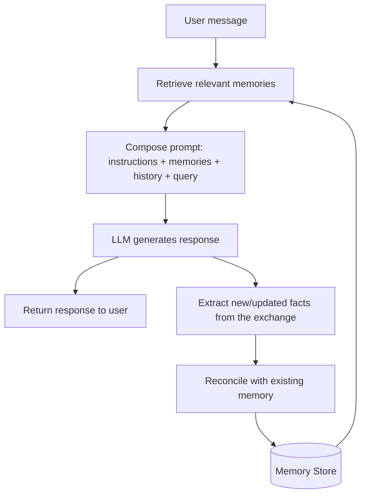

# 07. Context Engineering

<div align="center">
  <table>
    <tr>
      <td align="center"></td>
      <td align="center"></td>
    </tr>
  </table>
</div>
<br/>

---

<div align="center">
  <table>
    <tr>
      <td align="center"></td>
      <td align="center"></td>
      <td align="center"></td>
      <td align="center"></td>
      <td align="center"></td>
      <td align="center"></td>
      <td align="center"></td>
    </tr>
  </table>
</div>
<br/>

## 07.4. Memory Systems

### <td align="center"> Introduction

---

A raw LLM is **stateless**. Every API call starts from zero — the model has no inherent recollection of who the user is, what was said yesterday, or what preferences were established three sessions ago. Everything the model "knows" about the current interaction must be placed into the context window on every single call.

**Memory Systems** are the Context Engineering pillar that solves this. A memory system is the machinery that **captures, stores, retrieves, and re-injects** information *across* interactions, so that the model behaves as if it remembers — even though the model itself never does.

> **Core idea:** The model is stateless. The *system* around it is what gives the illusion of memory. Memory engineering is deciding **what** to remember, **where** to keep it, and **when** to bring it back into context.

This page focuses on memory as a **persistent, cross-session system component**. For managing the context window *within* a single conversation, see the related section **[05-Context-Management](https://github.com/gil-son/language-ai-engineering-lab/tree/main/05-Context-Management)**, and the short-term side of memory in **[07-5 State / History](./07-5-State-History.md)**.

---

### <td align="center"> Why use it?

---

Memory turns a one-shot tool into a product that improves with use. Each benefit maps to a concrete failure of a memoryless system:

- **Personalization** — remembers user preferences, tone, language, and constraints, instead of asking for them again every session.
- **Continuity** — a user can resume a task days later without re-explaining the whole backstory.
- **Efficiency** — relevant facts are retrieved on demand rather than stuffed into every prompt, saving tokens and cost.
- **Consistency** — the system gives the same answer about stable facts ("your plan is Enterprise") across sessions and agents.
- **Learning loop** — captured interactions become data for evaluation, personalization, and future fine-tuning.

> Without memory, every conversation is Groundhog Day: the system is competent but amnesiac, and the user pays the tax of repeating themselves forever.

---

### <td align="center"> Components

---

A memory system is built from a few functional parts. Understanding each one lets you design memory intentionally rather than accidentally.

#### Types of memory

| Type | Horizon | What it holds | Typical store |
|---|---|---|---|
| **Short-term (working)** | Current session | Recent turns of the conversation | In-context window / cache |
| **Long-term (persistent)** | Across sessions | Stable user facts & preferences | Database / vector store |
| **Episodic** | Across sessions | Records of specific past events/interactions | Log store / vector store |
| **Semantic** | Across sessions | Distilled facts & knowledge about the user/domain | Key-value / graph / vector store |
| **Procedural** | Across sessions | Learned workflows, routines, "how we do X" | Rules / config / prompt library |

> Short-term memory is covered as **[State / History (07-5)](./07-5-State-History.md)**. This page emphasizes the **long-term** types that survive beyond a single thread.

#### Functional pipeline

| Component | Role |
|---|---|
| **Writer / Extractor** | Decides what from an interaction is worth saving and distills it into a storable memory |
| **Store** | Where memories live (SQL, NoSQL, vector DB, graph DB, or a hybrid) |
| **Retriever** | Selects which stored memories are relevant to the current query |
| **Injector / Composer** | Formats retrieved memories and places them into the prompt |
| **Updater / Reconciler** | Resolves conflicts, updates stale facts, and merges duplicates |
| **Forgetter / Policy** | Expires, archives, or deletes memories (TTL, relevance decay, user request) |

---

### <td align="center"> How it works?

---

A memory system runs as a **loop around** the model: read memory *before* the call, write memory *after* it.

#### The memory loop



#### Step-by-step

1. **Trigger** — a new user message arrives.
2. **Retrieve** — query the memory store for facts relevant to this user and this message (semantic search, key lookup, or both).
3. **Compose** — inject the retrieved memories into the prompt alongside instructions, conversation history, and the query.
4. **Generate** — the model answers as if it "remembered."
5. **Extract** — after the turn, an extractor (often another LLM call) pulls out any new, durable facts ("user prefers metric units", "user's project is named Atlas").
6. **Reconcile** — compare new facts with existing ones: add, update, or discard on conflict.
7. **Persist** — write the result back to the store, with metadata (timestamp, source, confidence).
8. **Decay / forget** — periodically apply retention policy so memory stays fresh and bounded.

#### Retrieval strategies

| Strategy | How it selects memories | Best for |
|---|---|---|
| **Recency** | Most recently written first | Fast-moving, session-like context |
| **Semantic similarity** | Vector search against the query | Large, unstructured memory stores |
| **Keyed lookup** | Direct fetch by user ID / attribute | Stable structured facts (plan, locale) |
| **Importance-weighted** | Score by relevance × importance × recency | Human-like memory (à la generative agents) |
| **Hybrid** | Combine keyed facts + semantic episodes | Most production systems |

#### A minimal shape (illustrative)

```python
# Pseudocode — the memory loop around a stateless model
def respond(user_id, message):
    memories = memory.retrieve(user_id, query=message, k=5)   # read before
    prompt = compose(system_prompt, memories, history, message)
    answer = llm(prompt)

    facts = extract_facts(message, answer)                     # write after
    memory.reconcile(user_id, facts)                           # update/merge
    return answer
```

---

### <td align="center"> Use Cases

---

| Domain | How memory is used |
|---|---|
| **Customer support** | Remembers past tickets, product owned, and preferred resolution style, so the user never re-explains their setup |
| **Personal assistants** | Retains preferences (diet, timezone, writing tone) and ongoing goals across sessions |
| **Coding agents** | Remembers project conventions, stack, and prior decisions to stay consistent across a repo |
| **Healthcare assistants** | Maintains patient history and context (with strict privacy controls) alongside clinical guidelines |
| **Education / tutoring** | Tracks a learner's progress, weak spots, and mastered topics to adapt difficulty |
| **Sales & CRM copilots** | Recalls account history, past conversations, and open deals to personalize outreach |

---

###  Limitations

---

Memory is powerful but introduces real risks that must be designed for:

- **Staleness & contradiction** — facts change ("user moved to a new company"); without an update policy, memory becomes wrong and contradictory.
- **Memory poisoning** — a bad extraction or malicious input can store false "facts" that corrupt every future answer.
- **Privacy & compliance** — persisting user data triggers PII handling, consent, retention limits, and the right to be forgotten (GDPR/LGPD).
- **Retrieval errors** — the wrong memories retrieved (or the right ones missed) degrade answers in ways that are hard to debug.
- **Unbounded growth** — without forgetting policies, stores bloat, retrieval slows, and relevance drops.
- **Cost & latency** — extraction and retrieval add extra model calls and database round-trips to every interaction.
- **Over-personalization** — too much memory can trap a user in a stale profile ("filter bubble") or surface context they expected to be forgotten.

> Treat memory as a first-class, governed data asset — with a schema, an update policy, a retention policy, and an audit trail — not as an ever-growing log you never prune.

---

###  Video

---

A recommended video to visualize:

<div align="center">
  <a href="https://www.youtube.com/watch?v=VKPngyO0iKg" target="_blank">
      
  </a>
</div>

---

###  Related

---

- **[05-Context-Management](https://github.com/gil-son/language-ai-engineering-lab/tree/main/05-Context-Management)** — managing context within a single interaction
- **[07-5 State / History](./07-5-State-History.md)** — short-term memory of the active conversation
- **[07-3 RAG Pipelines (Review)](./07-3-RAG-Pipelines-Review.md)** — retrieving external knowledge (vs. retrieving user memory)
