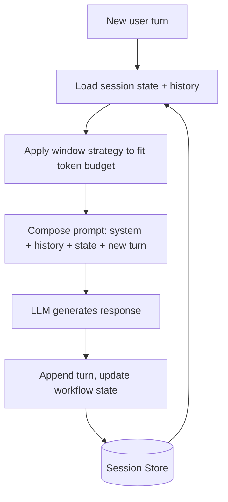

# 07. Context Engineering

<div align="center">
  <table>
    <tr>
      <td align="center"></td>
      <td align="center"></td>
    </tr>
  </table>
</div>
<br/>

---

<div align="center">
  <table>
    <tr>
      <td align="center"></td>
      <td align="center"></td>
      <td align="center"></td>
      <td align="center"></td>
      <td align="center"></td>
      <td align="center"></td>
      <td align="center"></td>
    </tr>
  </table>
</div>
<br/>

## 07.5. State / History

### <td align="center"> Introduction

---

Because an LLM is **stateless**, a multi-turn conversation only feels coherent because the system **replays the prior turns** back into the prompt on every call. **State / History** is the Context Engineering pillar responsible for the **short-term memory of the active thread** — the running record of what has been said in *this* conversation, plus any transient variables the workflow is tracking right now.

It is the counterpart to long-term **[Memory Systems (07-4)](./07-4-Memory-Systems.md)**:

| | State / History (this page) | Memory Systems (07-4) |
|---|---|---|
| **Horizon** | The current session / thread | Across sessions, long-term |
| **Lifetime** | Lives and dies with the conversation | Persisted indefinitely |
| **Holds** | Turn-by-turn messages, workflow state | Distilled, durable facts |
| **Main challenge** | Fitting history into the context window | What to store and when to recall |

> **Core idea:** The model forgets the previous message the instant it finishes answering. History is the system faithfully handing the whole conversation back to the model, turn after turn — within the hard limit of the context window.

For packing, truncating, and summarizing context within a window, this page pairs closely with **[05-Context-Management](https://github.com/gil-son/language-ai-engineering-lab/tree/main/05-Context-Management)**.

---

### <td align="center"> Why use it?

---

Conversation state is what separates a coherent assistant from a goldfish. Each benefit addresses a failure of a stateless call:

- **Coherence** — the model can resolve references ("make *it* shorter", "what about the *second* one?") because the prior turns are present.
- **Multi-step tasks** — workflows that span several turns (booking, troubleshooting, form-filling) need the intermediate state carried forward.
- **Context carry-over** — constraints stated early ("I'm vegetarian") remain in effect later in the same conversation.
- **Agent control flow** — agentic systems track *where they are* (plan, current step, tool results) as explicit state between steps.
- **Recoverability** — persisted session state lets a dropped connection resume exactly where it left off.

> Without managed state, every turn is a cold start: the user must re-state context constantly, and multi-step tasks become impossible.

---

### <td align="center"> Components

---

Two distinct things are often bundled under "state": the **message history** and the **structured workflow state**.

#### 1. Conversation history

The ordered list of turns, usually as role-tagged messages:

```json
[
  { "role": "system",    "content": "You are a helpful travel assistant." },
  { "role": "user",      "content": "I want a 5-day trip to Lisbon." },
  { "role": "assistant", "content": "Great! What's your budget?" },
  { "role": "user",      "content": "Around 1500 euros, vegetarian food please." }
]
```

#### 2. Structured / workflow state

Variables the application tracks explicitly, separate from the prose:

```json
{
  "session_id": "a1b2c3",
  "intent": "trip_planning",
  "slots": { "destination": "Lisbon", "days": 5, "budget_eur": 1500, "diet": "vegetarian" },
  "step": "awaiting_hotel_preference",
  "tools_called": ["flight_search"]
}
```

#### Supporting components

| Component | Role |
|---|---|
| **Session store** | Where history and state live between turns (memory cache, Redis, DB) |
| **Serializer** | Converts messages/state to and from the model's message format |
| **Window manager** | Keeps the replayed history within the token budget (see below) |
| **Summarizer** | Compresses older turns into a running summary when they no longer fit |
| **State reducer** | Updates workflow state as new information and tool results arrive |

---

### <td align="center"> How it works?

---

On each turn the system **rehydrates** context, calls the model, then **persists** the updated state.



#### The central problem: the window is finite

History grows every turn, but the context window does not. Eventually the full transcript no longer fits. The strategies below manage that tension (covered in depth in **[05-Context-Management](https://github.com/gil-son/language-ai-engineering-lab/tree/main/05-Context-Management)**):

| Strategy | How it works | Trade-off |
|---|---|---|
| **Full history** | Replay every turn verbatim | Simplest; breaks once the window overflows |
| **Sliding window** | Keep only the last *N* turns | Cheap; silently drops early context |
| **Summarization** | Replace old turns with a running summary | Saves tokens; loses verbatim detail |
| **Hybrid (summary + recent)** | Summary of old turns **+** last *N* verbatim | Best general default |
| **Selective / semantic recall** | Retrieve only the past turns relevant to the new query | Precise; adds retrieval complexity |

#### Step-by-step

1. **Load** the session's history and structured state from the store.
2. **Fit** it to the budget with a window strategy (truncate, summarize, or selectively recall).
3. **Compose** the prompt: system instructions + fitted history + current state + new user turn.
4. **Generate** the response.
5. **Reduce** state: append the new turn, update slots/step, record tool results.
6. **Persist** the updated history and state back to the session store.
7. On session end, optionally **distill** durable facts into long-term **[Memory (07-4)](./07-4-Memory-Systems.md)**.

---

### <td align="center"> Use Cases

---

| Domain | How state / history is used |
|---|---|
| **Chat assistants** | Replays the dialogue so references and follow-ups stay coherent |
| **Multi-step forms / booking** | Tracks filled slots and the current step until the task completes |
| **Troubleshooting flows** | Remembers which steps were already tried this session |
| **Agentic workflows** | Carries the plan, current step, and tool outputs between reasoning cycles |
| **Voice / IVR systems** | Maintains dialogue state across turns under tight latency budgets (see 17-AI-IVR-Specifics) |
| **Long documents co-editing** | Keeps a running summary of decisions made earlier in the session |

---

###  Limitations

---

- **Window overflow** — long conversations inevitably exceed the context window; something must be dropped or compressed.
- **"Lost in the middle"** — models attend less reliably to information buried in the middle of a long history.
- **Summarization drift** — repeated re-summarization can distort or silently lose important details.
- **Silent truncation** — a naive sliding window can drop a critical early constraint without any signal.
- **Cost scales with history** — replaying more turns means more input tokens on every single call.
- **State sprawl** — poorly structured workflow state becomes hard to debug and reason about.
- **Consistency across instances** — in distributed deployments, session state must be shared correctly or turns desync.

> Decide *explicitly* what the system is allowed to forget within a session, and make that policy observable — silent forgetting is the most common source of "the assistant suddenly ignored what I said."

---

###  Related

---

- **[05-Context-Management](https://github.com/gil-son/language-ai-engineering-lab/tree/main/05-Context-Management)** — windowing, truncation, and summarization in depth
- **[07-4 Memory Systems](./07-4-Memory-Systems.md)** — long-term memory across sessions
- **[07-6 Structured Outputs](./07-6-Structured-Outputs.md)** — typing the workflow state the model reads and writes
