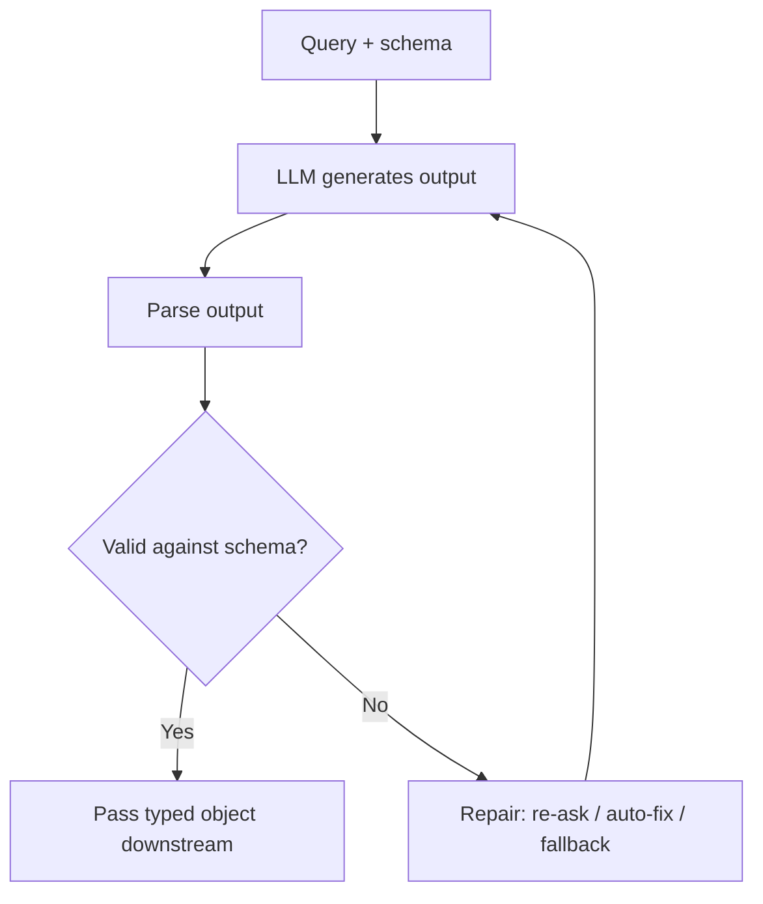

# 07. Context Engineering

<div align="center">
  <table>
    <tr>
      <td align="center"></td>
      <td align="center"></td>
    </tr>
  </table>
</div>
<br/>

---

<div align="center">
  <table>
    <tr>
      <td align="center"></td>
      <td align="center"></td>
      <td align="center"></td>
      <td align="center"></td>
      <td align="center"></td>
      <td align="center"></td>
      <td align="center"></td>
    </tr>
  </table>
</div>
<br/>

## 07.6. Structured Outputs

### <td align="center"> Introduction

---

By default an LLM returns **free-form prose** — natural for a human to read, but unreliable for a program to parse. The moment an LLM becomes a *component inside a system* (feeding a database, triggering an API, routing to another agent), its output must be **predictable, typed, and machine-readable**.

**Structured Outputs** is the Context Engineering pillar that makes the model's response conform to a **defined schema** — JSON, a typed object, a function-call signature — so that downstream code can consume it safely and deterministically.

> **Core idea:** Free text is for humans. Structured output is the **contract** between the model and the rest of your system. Context Engineering treats the *output format* as a first-class part of the context, not an afterthought.

This closes the loop of the context system: just as you engineer what goes **into** the model (instructions, RAG, memory, history), you engineer the shape of what comes **out**.

---

### <td align="center"> Why use it?

---

Structured output is what makes an LLM safe to wire into software. Each benefit removes a class of integration failure:

- **Parsability** — `response.sentiment` instead of regexing a paragraph; the output drops straight into code.
- **Reliability** — a schema constrains the model to valid shapes, eliminating "it answered in a different format this time."
- **Composability** — one component's typed output becomes the next component's typed input, enabling pipelines and multi-agent flows.
- **Tool & function calling** — structured arguments are what let a model actually *call* APIs and tools correctly.
- **Validation** — a schema is a built-in test: malformed output is detected immediately, not three steps later.
- **Reduced prompt overhead** — a clear schema often replaces pages of "please format your answer as..." instructions.

> If you ever find yourself writing fragile string-parsing or regex to read an LLM's answer, that is the signal you needed structured outputs.

---

### <td align="center"> Components

---

#### The output contract

A structured output is defined by a **schema** — the single source of truth both sides agree on:

```json
{
  "name": "extract_ticket",
  "schema": {
    "type": "object",
    "properties": {
      "category": { "type": "string", "enum": ["billing", "technical", "account"] },
      "priority": { "type": "string", "enum": ["low", "medium", "high"] },
      "summary":  { "type": "string" },
      "needs_human": { "type": "boolean" }
    },
    "required": ["category", "priority", "summary", "needs_human"]
  }
}
```

#### Common formats

| Format | When to use |
|---|---|
| **JSON** | The default for structured data interchange |
| **JSON Schema** | JSON **plus** validation rules and types enforced |
| **Function / tool call** | When the output should trigger a specific tool with typed arguments |
| **Typed objects (Pydantic, Zod)** | When output maps directly to code classes with validation |
| **XML / tagged** | When wrapping reasoning and answer in labeled sections |
| **Enums / classification** | When the answer must be one of a fixed, closed set of labels |

#### Supporting components

| Component | Role |
|---|---|
| **Schema definition** | Declares the required shape, types, and constraints |
| **Format instruction** | Tells the model to produce output matching the schema |
| **Constrained decoding** | (When supported) forces the model to emit only schema-valid tokens |
| **Parser** | Deserializes the raw output into a typed object |
| **Validator** | Checks the parsed object against the schema |
| **Repair / retry** | Handles malformed output (re-ask, auto-fix, or fallback) |

---

### <td align="center"> How it works?

---

There are three levels of rigor, from a polite request to a hard guarantee.

#### Approaches, weakest to strongest

| Approach | Mechanism | Guarantee |
|---|---|---|
| **Prompt-and-pray** | Ask for JSON in the prompt | None — model *usually* complies |
| **Few-shot formatting** | Show examples of the exact shape | Higher compliance, still not guaranteed |
| **Schema / JSON mode** | Pass a schema the API enforces | Output is valid JSON matching the schema |
| **Constrained decoding** | Restrict token sampling to valid continuations | Structurally guaranteed by construction |
| **Function / tool calling** | Model emits a typed call the runtime validates | Typed arguments, validated before execution |

#### The validate-and-repair loop

Even with strong methods, production systems validate and recover:



#### Step-by-step

1. **Define** the schema that downstream code expects.
2. **Instruct / constrain** the model to produce output in that shape (prompt, schema mode, or constrained decoding).
3. **Generate** the response.
4. **Parse** the raw text into a structured object.
5. **Validate** it against the schema (types, required fields, enums, ranges).
6. **Repair** on failure — retry with the error fed back, auto-fix, or fall back to a safe default.
7. **Pass** the validated, typed object to the next component.

#### Minimal example (illustrative)

```python
from pydantic import BaseModel

class Ticket(BaseModel):
    category: str      # "billing" | "technical" | "account"
    priority: str      # "low" | "medium" | "high"
    summary: str
    needs_human: bool

# The schema is sent to the model; the response is parsed and validated into Ticket.
ticket = llm.parse(prompt, schema=Ticket)   # raises on invalid output
route(ticket)                                # safe to use typed fields
```

---

### <td align="center"> Use Cases

---

| Domain | How structured output is used |
|---|---|
| **Information extraction** | Pull entities, dates, and amounts from documents into typed records |
| **Classification / routing** | Return an enum label that routes a ticket, message, or request |
| **Tool & function calling** | Emit validated arguments so the model can call APIs and tools |
| **Agent workflows** | Produce the typed state and decisions passed between agents and steps |
| **Data pipelines** | Transform unstructured text into rows ready for a database or warehouse |
| **Form filling / slots** | Populate a defined set of fields with validated values |
| **Evaluation (LLM-as-judge)** | Return scores and verdicts in a fixed schema for aggregation |

---

###  Limitations

---

- **Format vs. quality** — a schema guarantees the *shape* is valid, not that the *values* are correct; `priority: "high"` can still be the wrong call.
- **Rigidity** — over-constrained schemas can force the model to fit a square peg into a round hole, dropping nuance.
- **Error handling is mandatory** — even "guaranteed" modes fail on edge cases; a repair/fallback path is not optional.
- **Capability varies by model** — native schema/JSON modes and constrained decoding are not available everywhere; weaker models comply less reliably.
- **Token & latency overhead** — verbose schemas and retries add cost and latency.
- **Expressiveness limits** — deeply nested or highly dynamic schemas are harder for models to satisfy consistently.
- **Reasoning trade-off** — forcing a terse structured answer can suppress the step-by-step reasoning that improves accuracy (mitigate by allowing a reasoning field before the final fields).

> A schema makes output *parseable*, not *true*. Keep validating the semantics — and keep an evaluation layer (see 08-Evaluation-and-Benchmarks) on top of the structure.

---

###  Related

---

- **[05-Context-Management](https://github.com/gil-son/language-ai-engineering-lab/tree/main/05-Context-Management)** — structured outputs within context management
- **[07-5 State / History](./07-5-State-History.md)** — the typed workflow state the model reads and writes
- **[11-Model-Context-Protocol](https://github.com/gil-son/language-ai-engineering-lab/tree/main/11-Model-Context-Protocol)** — typed tool/data interfaces at the protocol level
