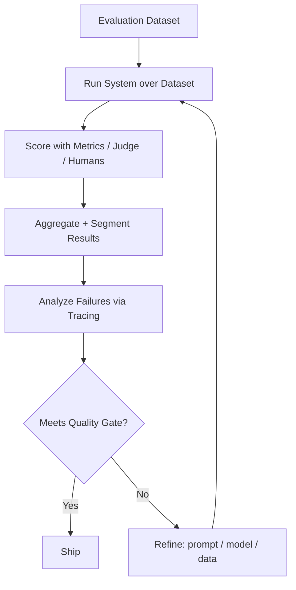

# 08. Evaluation and Benchmarks

##  Overview

**Evaluation** is the discipline of measuring, systematically and repeatably, whether an LLM system is good enough — and whether each change makes it better or worse. **Benchmarks** are the standardized datasets and tasks used to compare systems on common ground.

> **"Is the system good enough, and did this change improve it or regress it?"**

Where a one-off "looks good to me" check is subjective and fragile, systematic evaluation turns quality into **numbers you can track over time, compare, and gate releases on**. This section covers metrics, datasets, evaluation methods (automatic, model-based, and human), regression testing, and the tracing needed to debug failures.

| Aspect | Ad-hoc Testing | Systematic Evaluation |
|--------|----------------|------------------------|
| Signal | "Seems fine" | Measured scores |
| Repeatable | No | Yes, versioned datasets |
| Catches regressions | By luck | By design (in CI) |
| Comparison | Anecdotal | Apples-to-apples benchmarks |
| Scope | Single example | Whole test suite |

---

### <td align="center"> Introduction

An LLM feature can look great on three hand-picked prompts and fail on the fourth. Because model outputs are **non-deterministic** and inputs are open-ended, confidence requires evaluation over a representative set — not a demo.

This section builds on the pipeline-level metrics introduced in **[01-2-4 Evaluation](https://github.com/gil-son/language-ai-engineering-lab/tree/main/01-Human-Language-and-NLP/01-2-NLP-NLU-NLG-Pipeline/01-2-4-Evaluation-Refining-the-System)**, but raises the altitude to the **whole system**: benchmarks, regression suites, LLM-as-a-judge, cost and latency tracking, and release gates.

> **Key mindset:** evaluation is not a phase at the end — it is the instrument panel you build *first*, so every later change is measurable.

---

### <td align="center"> Why use it?

- **Trust** — know the system works before users do
- **Regression safety** — catch quality drops when prompts, models, or data change
- **Objective comparison** — choose models and strategies with evidence, not opinion
- **Release gates** — block deployments that fall below a quality bar
- **Cost & latency control** — track efficiency alongside quality
- **Faster iteration** — a good eval harness turns guesswork into a measured loop

---

### <td align="center"> Components

| Component | Role |
|-----------|------|
| **Evaluation Dataset** | Curated inputs with expected outputs (the "golden set"), versioned |
| **Metrics** | Accuracy, F1, BLEU, ROUGE, BERTScore, groundedness, perplexity |
| **Automatic Evaluators** | Reference-based and reference-free scoring |
| **LLM-as-a-Judge** | A strong model scores correctness, relevance, tone |
| **Human Evaluation** | Ratings, pairwise preference, A/B tests — the gold standard |
| **Benchmarks** | Standard datasets/tasks (MMLU, HELM, etc.) for comparison |
| **Regression Suite** | A fixed set run on every change to detect drift |
| **Tracing & Observability** | Per-step logs to debug *why* an output scored low |
| **Cost / Latency Tracking** | Tokens, p95 latency, and $/query per run |

---

### <td align="center"> How it works?



1. **Build a representative dataset** covering real usage and edge cases.
2. **Run** the system over it and capture outputs (plus latency and cost).
3. **Score** with the right mix of automatic metrics, LLM-judge, and human review.
4. **Aggregate and segment** — overall score hides failure modes; inspect by category.
5. **Trace failures** to the step that caused them.
6. **Gate**: pass or block the release against a defined threshold.

---

### <td align="center"> Use Cases

- **Model / prompt selection** with objective scores
- **CI regression testing** to block quality drops before merge
- **RAG evaluation** — retrieval relevance and answer groundedness
- **Benchmarking** against public datasets and leaderboards
- **A/B testing** new prompts or models in production
- **Cost/latency budgeting** for production SLAs

---

###  Limitations

- **Metrics are proxies** — a high score is not a guarantee of correctness
- **Benchmarks can be contaminated** — test data may leak into training
- **Golden sets go stale** and need maintenance as the domain evolves
- **LLM-as-a-judge has biases** (position, verbosity, self-preference)
- **Human eval is slow and costly**, and raters disagree
- **Single numbers hide tail failures** — always read the worst cases

---

##  Topics Covered

```
08-Evaluation-and-Benchmarks/
├── Metrics (accuracy, F1, BLEU, ROUGE, BERTScore, perplexity)
├── Reference-free & LLM-as-a-judge evaluation
├── Human evaluation and preference testing
├── Benchmarks and leaderboards
├── Regression testing in CI
├── Groundedness / faithfulness (RAG evaluation)
└── Tracing, cost, and latency tracking
```

---

###  Related

- **[01-2-4 Evaluation — Metrics & Feedback](https://github.com/gil-son/language-ai-engineering-lab/tree/main/01-Human-Language-and-NLP/01-2-NLP-NLU-NLG-Pipeline/01-2-4-Evaluation-Refining-the-System)** — pipeline-level foundations
- **[09-Harness-Engineering](https://github.com/gil-son/language-ai-engineering-lab/tree/main/09-Harness-Engineering)** — the machinery that runs these evaluations
- **[10-Hallucinations-and-Factuality](https://github.com/gil-son/language-ai-engineering-lab/tree/main/10-Hallucinations-and-Factuality)** — measuring and reducing false outputs
