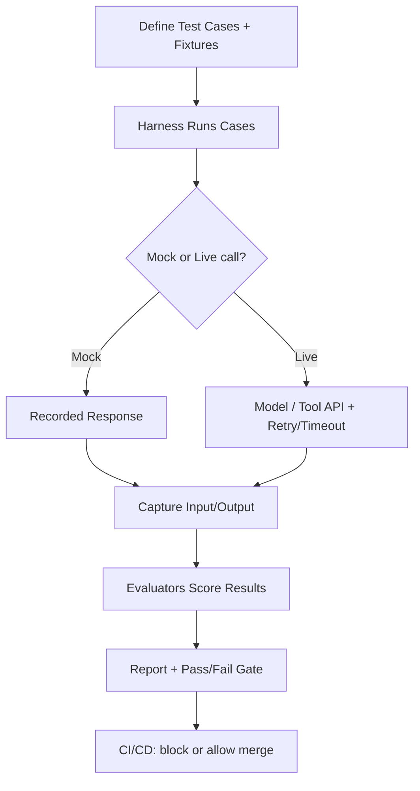

# 09. Harness Engineering

##  Overview

A **test harness** is the machinery that **runs** LLM tests and evaluations reliably, repeatably, and automatically. If [Evaluation](https://github.com/gil-son/language-ai-engineering-lab/tree/main/08-Evaluation-and-Benchmarks) defines *what* to measure, **Harness Engineering** builds the scaffolding that *actually runs the tests*, captures every input and output, handles failures, and plugs the whole thing into CI/CD.

> **"How do I run, capture, and automate LLM tests so results are reliable and reproducible?"**

A harness turns evaluation from a manual, copy-paste ritual into an engineered pipeline: define cases once, run them on every change, and get a report and a pass/fail gate automatically.

| Aspect | Manual Prompting | Test Harness |
|--------|------------------|--------------|
| Execution | By hand, one at a time | Automated over a suite |
| Reproducibility | Low | High (fixtures, seeds, versions) |
| Failure handling | Ad-hoc | Retries, timeouts, mocks |
| Output capture | Screenshots / memory | Structured, logged, diffable |
| Integration | None | Runs in CI/CD on every change |

---

### <td align="center"> Introduction

Testing LLM systems is harder than testing ordinary code: outputs are **non-deterministic**, calls are **slow and costly**, and dependencies (model APIs, vector stores, tools) are **external and flaky**. A naive test suite is either unreliable (random failures) or impractically expensive.

Harness Engineering solves this with purpose-built scaffolding: deterministic fixtures, mocking of external calls, retry and timeout logic, structured capture of inputs and outputs, and evaluators that score the results. The harness is the bridge between a pile of test ideas and a trustworthy, automated quality gate.

> **Key mindset:** treat prompts and LLM behavior as software under test — with fixtures, snapshots, retries, and CI — not as something you eyeball.

---

### <td align="center"> Why use it?

- **Reproducibility** — same inputs, same conditions, comparable results
- **Automation** — run the full suite on every commit, not by hand
- **Reliability** — retries, timeouts, and mocks tame flaky external calls
- **Capture** — every input/output is logged for debugging and regression
- **Cost control** — caching and mocking cut redundant API spend
- **Confidence to ship** — a green suite in CI gates releases objectively

---

### <td align="center"> Components

| Component | Role |
|-----------|------|
| **Test Runner / Scaffold** | Orchestrates test cases and collects results |
| **Input/Output Capture** | Records prompts, responses, and metadata for each run |
| **Fixtures & Seeds** | Fixed inputs and settings for reproducibility |
| **Mocking Layer** | Replaces live model/tool calls with recorded responses |
| **Retry & Timeout Logic** | Handles transient API failures gracefully |
| **Evaluators** | Apply metrics / LLM-judge to score captured outputs |
| **Snapshot / Golden Files** | Detect changes by diffing against saved outputs |
| **Reporting** | Human-readable results, pass/fail, trends |
| **CI/CD Integration** | Runs the suite automatically and enforces gates |

---

### <td align="center"> How it works?



1. **Define** test cases with fixed inputs and expected behavior.
2. **Run** them through the harness, mocking external calls where determinism matters.
3. **Capture** every input, output, and metric (latency, tokens, cost).
4. **Evaluate** the captured outputs with metrics or an LLM judge.
5. **Report** results and compare against snapshots/thresholds.
6. **Gate** in CI/CD — fail the build if quality regresses.

---

### <td align="center"> Use Cases

- **Prompt regression testing** — detect when a prompt edit breaks behavior
- **Model upgrade validation** — re-run the suite before switching models
- **RAG pipeline testing** — mock retrieval to test generation deterministically
- **Agent/tool testing** — mock tool calls to test reasoning paths
- **CI quality gates** — block merges that drop below a threshold
- **Cost/latency guardrails** — fail builds that exceed budgets
- **Snapshot testing** — catch unexpected output changes via diffs

---

###  Limitations

- **Non-determinism** — even with fixtures, live model outputs vary
- **Mock drift** — recorded responses go stale as real models change
- **Maintenance cost** — snapshots and fixtures need upkeep
- **Flaky externals** — retries help but cannot fully hide unreliable APIs
- **Cost of live runs** — full live suites can be expensive and slow
- **Coverage gaps** — a harness only tests the cases you thought to write

---

##  Topics Covered

```
09-Harness-Engineering/
├── Test scaffolding and runners
├── Input/output capture and logging
├── Mocking model and tool calls
├── Retry, timeout, and rate-limit handling
├── Snapshot / golden-file testing
├── Evaluator integration (metrics, LLM-judge)
└── CI/CD integration and quality gates
```

---

###  Related

- **[08-Evaluation-and-Benchmarks](https://github.com/gil-son/language-ai-engineering-lab/tree/main/08-Evaluation-and-Benchmarks)** — defines the metrics the harness runs
- **[15-MLOps-and-Production](https://github.com/gil-son/language-ai-engineering-lab/tree/main/15-MLOps-and-Production)** — deploying and monitoring what the harness validates
