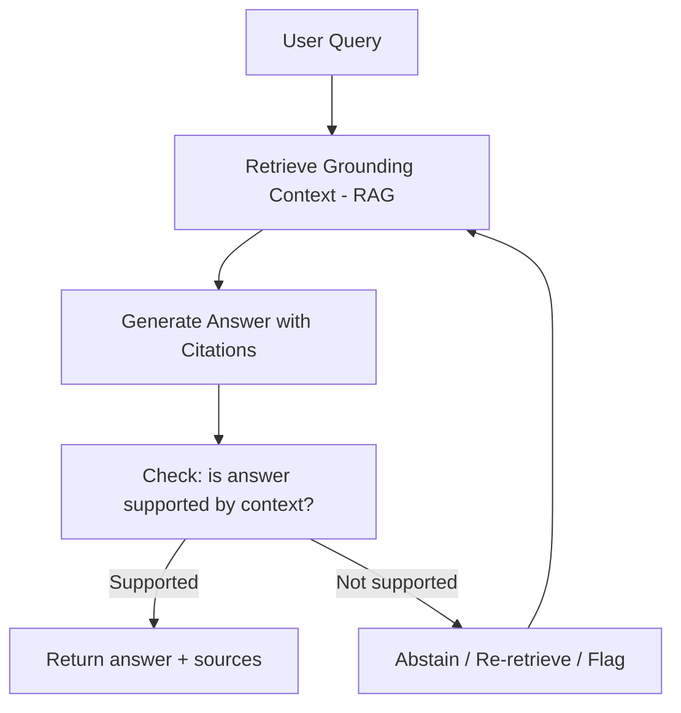

# 10. Hallucinations and Factuality

##  Overview

A **hallucination** is when a model produces content that is **fluent and confident but false or unsupported**. **Factuality** is the opposite goal: outputs that are accurate and grounded in reliable evidence. This section covers *why* hallucinations happen, how to *classify* them, how to *detect* them, and the patterns that *reduce* them.

> **"Why does the model make things up, and how do we catch and reduce it?"**

Because an LLM generates the most *probable* continuation — not the most *true* one — fluency and correctness are independent. A confident, well-written answer can be entirely wrong. Managing that gap is one of the hardest and most important problems in applied Language AI.

| Aspect | Fluent but Hallucinated | Grounded and Factual |
|--------|-------------------------|-----------------------|
| Source | Model's parametric guess | Retrieved, cited evidence |
| Confidence | Often high | Appropriately calibrated |
| Verifiable | No | Yes, traceable to sources |
| Risk | High in critical domains | Lower, auditable |

---

### <td align="center"> Introduction

Hallucinations are not a bug to be patched once — they are an **inherent behavior** of probabilistic language models. The model fills gaps with plausible-sounding text, and when it lacks the knowledge, it invents.

This section treats hallucination as an engineering problem: name the failure modes, measure how often they occur, detect them automatically, and apply mitigation patterns (grounding, citations, verification) to push factuality up to an acceptable level for the use case.

> **Key mindset:** you cannot eliminate hallucinations entirely — you **design the system to reduce, detect, and contain** them.

---

### <td align="center"> Why use it?

- **Trust** — users abandon systems that confidently lie
- **Safety** — false outputs in medical, legal, or financial domains cause real harm
- **Compliance** — regulated domains require traceable, verifiable answers
- **Debuggability** — a taxonomy tells you *which kind* of error you are fixing
- **Measurability** — factuality metrics turn "feels wrong" into a tracked number
- **Groundedness** — citations let users verify answers themselves

---

### <td align="center"> Components

**Hallucination taxonomy**

| Type | Description | Example |
|------|-------------|---------|
| **Factual** | Contradicts real-world facts | Wrong date, invented statistic |
| **Faithfulness / contextual** | Contradicts the provided source | Answer not supported by retrieved text |
| **Structural** | Invents format artifacts | Fake citation, non-existent API, bad JSON |
| **Fabricated reference** | Cites sources that do not exist | Made-up paper title or URL |

**Common causes**
- Knowledge gaps in the model's training data
- Outdated parametric knowledge (no access to current facts)
- Weak or missing retrieval (bad grounding)
- Ambiguous prompts that invite guessing
- Over-long context ("lost in the middle")
- Decoding pressure to always produce an answer

**Detection strategies**
- Groundedness / faithfulness checks against retrieved context
- LLM-as-a-judge fact verification
- Self-consistency (sample multiple answers, compare)
- Citation / attribution validation
- Uncertainty and calibration signals

**Mitigation patterns**
- **RAG** — ground answers in authoritative sources
- **Citations** — require and verify source attribution
- **"I don't know"** — allow and reward abstention
- **Constrained outputs** — schemas to prevent structural fabrication
- **Verification step** — a second pass that checks the first

---

### <td align="center"> How it works?

A detection-and-mitigation loop around generation:



1. **Ground** the query in retrieved, authoritative context.
2. **Generate** an answer constrained to that context, with citations.
3. **Verify** that each claim is supported (faithfulness check).
4. **Contain** unsupported claims — abstain, re-retrieve, or flag for review.
5. **Measure** hallucination rate over an evaluation set and track it over time.

---

### <td align="center"> Use Cases

- **Enterprise Q&A** — answers grounded and cited from internal docs
- **Medical / legal assistants** — verifiable, source-backed responses
- **Research assistants** — real, checkable citations
- **Customer support** — accurate answers from product knowledge bases
- **Summarization** — faithfulness to the source document
- **Agentic systems** — verify tool outputs before acting on them

---

###  Limitations

- **Cannot be fully eliminated** — only reduced and contained
- **Detection is imperfect** — verifiers hallucinate too
- **Grounding ceiling** — RAG is only as good as its retrieval
- **Abstention trade-off** — too much "I don't know" hurts usefulness
- **Cost & latency** — verification passes add overhead
- **Subtle errors** — small factual slips are hard to catch automatically

---

##  Topics Covered

```
10-Hallucinations-and-Factuality/
├── Hallucination taxonomy (factual, faithfulness, structural)
├── Root causes and failure modes
├── Detection strategies (groundedness, self-consistency, LLM-judge)
├── Grounding techniques (RAG, citations, attribution)
├── Mitigation patterns (abstention, verification, constraints)
└── Measuring factuality over time
```

---

###  Related

- **[06-RAG-Pipeline](https://github.com/gil-son/language-ai-engineering-lab/tree/main/06-RAG-Pipeline)** — grounding as the primary mitigation
- **[08-Evaluation-and-Benchmarks](https://github.com/gil-son/language-ai-engineering-lab/tree/main/08-Evaluation-and-Benchmarks)** — measuring groundedness and factuality
- **[07-Context-Engineering](https://github.com/gil-son/language-ai-engineering-lab/tree/main/07-Context-Engineering)** — assembling trustworthy context
