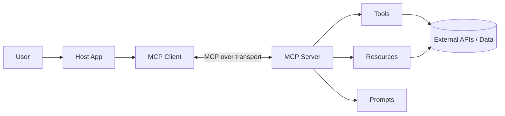

# 11. Model Context Protocol (MCP)

##  Overview

The **Model Context Protocol (MCP)** is an open standard for connecting LLM applications to **external tools and data sources** through a single, consistent interface. Instead of writing bespoke glue code for every integration, an application speaks MCP — and any MCP-compatible server (files, databases, APIs, search) plugs in the same way.

> **"How do models access external tools and data in a standard, secure, reusable way?"**

MCP is often described as a "USB-C for AI": one protocol so that tools and data sources built once can be reused across many AI applications.

| Aspect | Custom Per-Integration Glue | Model Context Protocol |
|--------|-----------------------------|------------------------|
| Integration effort | New code for every tool | One protocol, many servers |
| Reusability | Locked to one app | Server works across any MCP host |
| Discovery | Hard-coded | Capabilities advertised at runtime |
| Maintenance | N integrations to maintain | Standard interface |
| Security | Ad-hoc per integration | Defined boundaries and permissions |

---

### <td align="center"> Introduction

As LLMs move from chat to **agents** that act in the real world, they need to read files, query databases, call APIs, and use tools. Historically each of these was a one-off integration, tightly coupled to a single application.

MCP standardizes that connection. A **host** application (an IDE, a chat client, an agent) connects through an **MCP client** to one or more **MCP servers**, each exposing capabilities in a common format. This decouples *what the model can do* from *how each app is built*, so integrations are reusable and composable.

> **Key mindset:** MCP is the interface layer between the model and the outside world — the standard contract for giving a model controlled access to tools and data.

---

### <td align="center"> Why use it?

- **Reusability** — build a tool/data server once, use it in any MCP host
- **Interoperability** — a common protocol across vendors and apps
- **Runtime discovery** — hosts learn a server's capabilities dynamically
- **Separation of concerns** — tool authors and app authors work independently
- **Security boundaries** — explicit, scoped access instead of ad-hoc glue
- **Ecosystem** — tap a growing library of ready-made servers

---

### <td align="center"> Components

**Architecture roles**

| Role | Description |
|------|-------------|
| **Host** | The LLM application the user interacts with (IDE, chat client, agent) |
| **Client** | The connector inside the host that speaks MCP to a server |
| **Server** | A program exposing tools/data/prompts over MCP |
| **Transport** | How client and server communicate (stdio, HTTP/SSE) |

**Server primitives (what a server exposes)**

| Primitive | Description | Example |
|-----------|-------------|---------|
| **Tools** | Actions the model can invoke | `search_web`, `run_query`, `send_email` |
| **Resources** | Data the model can read | Files, database rows, documents |
| **Prompts** | Reusable prompt templates/workflows | "Summarize this ticket" |

---

### <td align="center"> How it works?



1. **Connect** — the host's client opens a connection to an MCP server.
2. **Discover** — the client asks the server what tools, resources, and prompts it offers.
3. **Expose** — those capabilities are made available to the model (as callable tools).
4. **Invoke** — when the model decides to act, the client sends a structured request to the server.
5. **Execute** — the server performs the action (query, API call, file read) and returns a typed result.
6. **Ground** — the result is fed back into the model's context to inform the next step.

---

### <td align="center"> Use Cases

- **Coding assistants** — read the repo, run tests, query docs via MCP servers
- **Enterprise agents** — connect to internal databases and APIs safely
- **Knowledge access** — expose document stores as MCP resources
- **Workflow automation** — tools for tickets, email, calendars, CRMs
- **Multi-tool agents** — compose several servers into one capable agent
- **Data analysis** — let the model query warehouses through a controlled server

---

###  Limitations

- **Security surface** — tool access must be scoped, authenticated, and audited
- **Prompt injection risk** — untrusted resource content can try to hijack the model
- **Maturity** — the ecosystem and tooling are still evolving
- **Operational overhead** — servers must be deployed, secured, and maintained
- **Latency** — each tool round-trip adds time
- **Error handling** — servers and external APIs fail and must degrade gracefully

> Treat every MCP server as a trust boundary: validate inputs, scope permissions, and never let resource content be executed as instructions blindly.

---

##  Topics Covered

```
11-Model-Context-Protocol/
├── MCP architecture (host, client, server, transport)
├── Server primitives (tools, resources, prompts)
├── Building a custom MCP server
├── Connecting a host to servers
├── Security, permissions, and trust boundaries
└── Integrating MCP into agents and orchestration
```

---

###  Related

- **[13-Agentic-AI-Systems](https://github.com/gil-son/language-ai-engineering-lab/tree/main/13-Agentic-AI-Systems)** — agents that use MCP tools
- **[12-LLM-Orchestration](https://github.com/gil-son/language-ai-engineering-lab/tree/main/12-LLM-Orchestration)** — wiring tools into workflows
- **[07-Context-Engineering](https://github.com/gil-son/language-ai-engineering-lab/tree/main/07-Context-Engineering)** — tools as a context source
